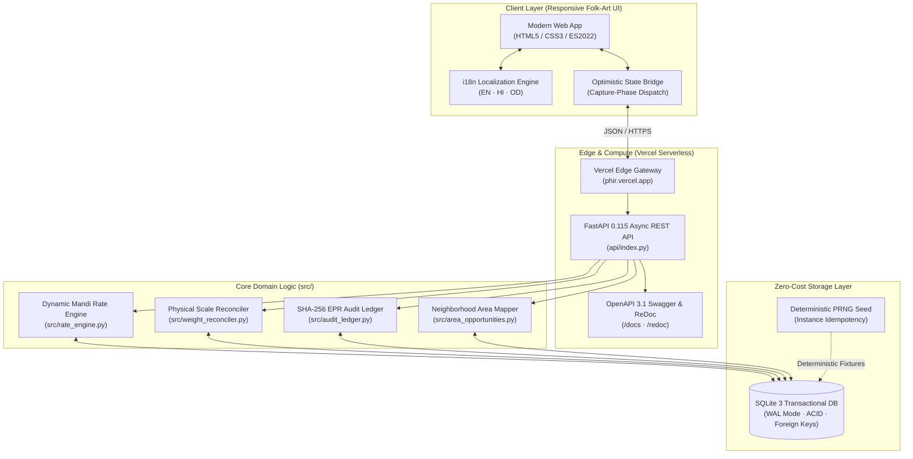

# Phir (फिर) — Environmental Resource Recovery Network

[](https://phir.vercel.app/)
[](https://github.com/kamilahmadhashmi/PHIR/actions)
[](https://phir.vercel.app/docs)
[](#-website-wide-multilingual-localization-en--hi--od)
[](#-zero-cost-engineering-strategy)
[](LICENSE)

> **Submission for Hackathon Showcase**  
> *Track: Sustainability • Climate Tech • Circular Economy • Digital Inclusion*  
>
> 🌐 **Live Web Application**: [https://phir.vercel.app](https://phir.vercel.app/)  
> 📖 **Interactive Swagger UI (OpenAPI 3.1)**: [https://phir.vercel.app/docs](https://phir.vercel.app/docs)  
> 📑 **API Reference (ReDoc)**: [https://phir.vercel.app/redoc](https://phir.vercel.app/redoc)  
> 💚 **Health & Production Telemetry**: [https://phir.vercel.app/healthz](https://phir.vercel.app/healthz)  
> 🎬 **Cinematic Interactive Story**: [https://phir.vercel.app/#story](https://phir.vercel.app/#story)

---

## 💡 The Problem & The Mission

Every day, **over 62 million tonnes of municipal solid waste** are generated across India. Less than 20% enters formal recycling channels; the remainder is dumped into open landfills or waterways.

Yet, India possesses one of the world's most resilient recycling foundations: **an informal grassroots workforce of 4+ million *kabadiwalas* (itinerant waste collectors) and aggregators**, responsible for diverting over **95% of all post-consumer plastic and paper** currently recycled.

Despite their critical ecological role, this informal circular economy remains bottlenecked by four core barriers:

1. **First-Mile Leakage**: Clean recyclables get mixed with organic wet waste at home doorsteps, losing commercial value before reaching collectors.
2. **Pricing Opacity**: Fragmented scrap Mandi rates create distrust between households and collectors.
3. **Physical Scale Friction**: Variations between estimated weight, scale readings, moisture, and contamination frequently stall pickups.
4. **The EPR Traceability Vacuum**: Brand owners and industrial recyclers desperately need auditable chain-of-custody data for statutory **Extended Producer Responsibility (EPR)** compliance, but informal handovers produce zero digital proof.

### 🔄 What is Phir?
**Phir (फिर — "Again")** is a decentralized resource recovery coordination network that bridges **Households**, **Grassroots Kabadiwalas**, and **Industrial Recyclers** into a transparent, fair, and cryptographically verified circular economy.

```text
┌──────────────┐      Collection Request      ┌─────────────────────┐      Aggregated Inventory      ┌─────────────────────┐
│  HOUSEHOLD   │ ───────────────────────────> │ KABADIWALA / RECOVERY│ ─────────────────────────────> │ INDUSTRIAL RECYCLER │
│  (Doorstep)  │ <─────────────────────────── │      PARTNER        │ <───────────────────────────── │    (Processing)     │
└──────────────┘     Fair Payout & Receipt    └─────────────────────┘      EPR Audit Certificate     └─────────────────────┘
```

---

## ⚡ 3-Minute Hackathon Judge Walkthrough

Experience the complete end-to-end lifecycle live on [https://phir.vercel.app](https://phir.vercel.app/):

| Step | Persona | What to do on [phir.vercel.app](https://phir.vercel.app) | Real-world Mechanism |
| :--- | :--- | :--- | :--- |
| **1** | **Household** | Click **Household** role. Browse available materials or click `+ Add material` (e.g. 3.5 kg PET plastic). Click **Request a collection**. | Aggregates materials into a pending neighborhood pickup request. Live rate quotes calculated via Mandi Rate Engine. |
| **2** | **Collection Partner** | Switch role to **Collection partner**. Explore the interactive SVG Delhi district map. Click **Accept** on any pending opportunity card. Click **Mark collected**. | Live matching without revealing private residential addresses. Dispatches physical weight reconciliation & contamination adjustment. |
| **3** | **Industrial Recycler** | Switch role to **Recycler**. Browse live recovered inventory across Delhi. Click **Reserve material** against corporate recycling quotas. Confirm the handover. | Transfers material custody, fulfills regulatory requirements, and issues immutable SHA-256 EPR verification logs. |
| **★** | **Interactive Story** | Click **Enter the story** from the home screen. Scroll through cinematic chapters and play **The First-Mile Challenge** dispatch mini-game. | Cultural awareness game testing rapid material separation under time pressure with streak bonuses. |

---

## ✨ Key Innovation Highlights

### 🎨 1. Indian Truck-Art Cultural Design System
Rejecting sterile corporate dashboard aesthetics, Phir adopts a vivid design language rooted in Indian transport culture:
- **Hand-painted Truck Art Motif**: Typography, ornamental border stamps, paper grain textures, and highway truck transition sweeps.
- **Micro-Interactions & Fluid Motion**: Built with native CSS, SVG graphics, Lenis smooth scrolling, and Canvas-based ambient crowd simulation.
- **Zero Heavy Framework Bloat**: First Contentful Paint (FCP) of **<0.5s** with minimal bundle footprint.

### 🌐 2. Zero-Reload Multilingual Localization (EN • हिन्दी • ଓଡ଼ିଆ)
Empowering non-English-speaking grassroots collectors is paramount:
- **Zero-Latency Tri-Lingual Switching**: Seamlessly toggle between English (`EN`), हिन्दी (`HI`), and ଓଡ଼ିଆ (`OD`) via the navigation bar.
- **In-Place Reactive Translation**: Swaps interface copy, form labels, Mandi rate cards, and toast alerts in-place without triggering page reloads or losing active input state.
- **100% Free & Self-Contained**: Powered entirely by static dictionaries in `frontend/phir-i18n.js`—zero paid translation APIs or external network calls.

### ⚖️ 3. Physical Scale Weighing Reconciliation
In real scrap recovery, household estimates rarely match certified scale readings:
- Handles **scale variance, moisture retention, and foreign matter contamination** (0% to 20%).
- Automatically reconciles estimated amounts against physical certified scale receipts.
- Generates adjusted unit payouts and transparent digital settlement receipts.

### 🔐 4. Cryptographic EPR Chain-of-Custody Audit Ledger
- Every critical event (`REQUEST_CREATED`, `REQUEST_ACCEPTED`, `COLLECTION_RECORDED`, `MATERIAL_RESERVED`, `HANDOVER_COMPLETED`) is cryptographically sealed into an append-only audit ledger.
- Generates **tamper-evident SHA-256 digital proof digests** linking actor IDs, timestamps, quantities, and custody transfers.
- Ready for integration with Central Pollution Control Board (CPCB) EPR compliance portals.

### 🗺️ 5. Privacy-Preserving Neighborhood Locality Clustering
- Households never have their private home addresses, contact numbers, or exact coordinates exposed publicly.
- All requests are aggregated into **11 Delhi administrative districts** (Central, New Delhi, South, North West, Karol Bagh, Saket, etc.).
- Kabadiwalas optimize multi-stop collection routes while protecting citizen privacy.

### 💸 6. Permanent ₹0 / $0 Cost Architecture
Built from the ground up for zero hosting bills:
- **Vercel Serverless Function** ASGI engine hosting Python FastAPI (`@vercel/python`).
- **SQLite with WAL Mode** delivering zero-latency transactional consistency.
- **Deterministic Seed Mechanism** guaranteeing identical opportunity IDs and state parity across ephemeral serverless instances.

---

## 🏛️ System Architecture



---

## 🛠️ Technology Stack

| Component | Technology | Rationale |
| :--- | :--- | :--- |
| **Backend Framework** | **FastAPI 0.115 + Pydantic v2** | High-concurrency async Python, auto-generated OpenAPI 3.1 docs, strict schema validation. |
| **Database** | **SQLite 3 (WAL mode)** | Zero-cost, self-contained relational storage with ACID transactions and microsecond query latency. |
| **Audit Security** | **Python `hashlib` (SHA-256)** | Cryptographic proof generation for Extended Producer Responsibility (EPR) chain of custody. |
| **Frontend Core** | **Modern Vanilla ES2022+** | Zero framework overhead, zero compile lag, instant hydration, and 100% browser standard adherence. |
| **Animation & UX** | **Lenis + GSAP + HTML5 Canvas** | Inertial smooth scrolling, custom sprite-sheet crowd walking simulation, and GPU-accelerated page sweeps. |
| **Mapping Engine** | **Interactive Vector SVG** | Responsive 11-district Delhi map with interactive pin clustering and locality selection. |
| **Hosting & CDN** | **Vercel Serverless (`@vercel/python`)** | Global CDN edge caching, automatic HTTPS, continuous deployment from GitHub `main`. |
| **Containerization** | **Docker + Docker Compose** | Multi-stage slim build (<150MB image) for instant local replication and self-hosted deployments. |
| **CI / CD Pipeline** | **GitHub Actions** | Matrix test automation on Python 3.11, 3.12, and 3.13 on every push and pull request. |

---

## 📡 Live Interactive REST APIs

Explore, inspect, and execute every platform endpoint directly in your browser:
- **Interactive Swagger UI**: [https://phir.vercel.app/docs](https://phir.vercel.app/docs)
- **Technical ReDoc**: [https://phir.vercel.app/redoc](https://phir.vercel.app/redoc)
- **Raw OpenAPI 3.1 Specification**: [`docs/openapi.json`](docs/openapi.json)

### Core Endpoints Overview

| Method | Endpoint | Description |
| :--- | :--- | :--- |
| `GET` | `/healthz` | Platform health status, database connection, and uptime check |
| `POST` | `/api/demo/profiles` | Create or update demo profile (Household, Collector, or Recycler) |
| `GET` | `/api/households/{id}/materials` | Retrieve recorded household recyclables and active pickup requests |
| `POST` | `/api/materials` | Add recyclable item with estimated Mandi pricing |
| `POST` | `/api/collection-requests` | Bundle household materials into an active neighborhood collection request |
| `GET` | `/api/kabadiwalas/{id}/requests` | Retrieve locality-level collection opportunities for a collector |
| `POST` | `/api/collection-requests/{id}/accept` | Accept an open collection request (idempotent & self-healing) |
| `POST` | `/api/collection-requests/{id}/collect` | Record collection with physical scale weight & contamination deduction |
| `GET` | `/api/recyclers/{id}/available-material` | Browse verified collected scrap lots ready for recycling |
| `POST` | `/api/recycler-requirements` | Publish factory material requirements (e.g. 500 kg PET plastic) |
| `POST` | `/api/bookings` | Reserve a collected lot against a factory requirement |
| `POST` | `/api/bookings/{id}/confirm` | Complete custody handover and issue EPR verification audit record |
| `GET` | `/api/audit-events` | Query the immutable Extended Producer Responsibility (EPR) audit ledger |

---

## 🚀 Local Quickstart Guide

Want to run the complete stack locally? You only need Python 3.10+ installed.

### Option A: Standard Python (1 Minute Setup)

```bash
# 1. Clone the repository
git clone https://github.com/kamilahmadhashmi/PHIR.git
cd PHIR

# 2. Install dependencies
pip install -r requirements.txt

# 3. Launch the unified application
python run.py
```

Open **<http://localhost:8080>** in your browser.  
- Web application is served directly at `/`.
- Swagger UI is live at <http://localhost:8080/docs>.

### Option B: Docker Compose (Zero Configuration)

```bash
docker compose up --build
```

Access the application at **<http://localhost:8080>**. All database records persist automatically in `./data/phir.db`.

---

## 🧪 Comprehensive Automated Test Suite

Phir enforces strict test-driven development. The test suite covers HTTP contract testing, business logic integrity, physical reconciliation math, audit ledger cryptography, and multilingual dictionary parity:

```bash
python -m unittest discover -s tests -v
```

```text
Ran 44 tests in 1.459s

OK (44/44 tests passed)
```

### What We Test:
- **`tests/test_fastapi_server.py`**: Full lifecycle API integration tests across Household, Collector, and Recycler journeys.
- **`tests/test_i18n.py`**: 100% dictionary key parity across English, Hindi, and Odia (zero missing strings).
- **`tests/test_weight_reconciler.py`**: Mathematical verification of contamination deductions and fair unit payouts.
- **`tests/test_recovery_domain.py`**: State machine validation preventing invalid state transitions (e.g. collecting before accepting).
- **`tests/test_seed_data.py`**: Deterministic PRNG seed validation guaranteeing repeatable serverless initialization.

---

## 🗺️ Project Directory Structure

```text
PHIR/
├── api/
│   └── index.py               # Vercel Serverless Function entrypoint (ASGI adapter)
├── frontend/                  # Modern Folk-Art User Interface
│   ├── amplify-site/          # Production-optimized distribution bundle
│   ├── phir-i18n.js           # Zero-cost reactive tri-lingual localization engine
│   ├── phir-collector-api-bridge.js # Resilient collector bridge with capture-phase events
│   ├── phir-identity.js       # Lightweight role profile management
│   └── map/                   # Selectable vector SVG Delhi district map
├── src/                       # Backend Application Core
│   ├── main.py                # FastAPI routes, schemas, and endpoint definitions
│   ├── repository.py          # SQLite transactional repository layer
│   ├── recovery_domain.py     # Domain models & deterministic ID generator
│   ├── rate_engine.py         # Dynamic Delhi Mandi scrap pricing engine
│   ├── weight_reconciler.py   # Physical scale & contamination reconciliation
│   └── audit_ledger.py        # Cryptographic SHA-256 EPR audit logging
├── tests/                     # 44 automated unit, integration & parity tests
├── Dockerfile                 # Multi-stage production container (<150MB)
├── docker-compose.yml         # Container orchestration specification
├── vercel.json                # Vercel edge routing and serverless config
├── run.py                     # Local unified application runner
└── README.md                  # Hackathon project documentation
```

---

## 🔮 Future Roadmap & Real-World Scaling

1. **WhatsApp & SMS Bot Interface**: Expand collection request and acceptance notifications to simple SMS/WhatsApp flows for non-smartphone kabadiwalas via Twilio or Gupshup.
2. **On-Device Computer Vision**: Deploy lightweight MobileNet / YOLO models to auto-classify plastic resin codes (PET, HDPE, LDPE) from smartphone camera snaps without cloud API costs.
3. **Government CPCB EPR Portal Integration**: Direct API bridging with the Central Pollution Control Board portal to automatically convert verified Phir handovers into certified EPR credits for manufacturers.
4. **Municipal Open Data Export**: Enable urban local bodies (like MCD in Delhi) to download anonymized neighborhood recovery heatmaps to optimize municipal zero-waste zones.

---

## 📜 License

Distributed under the **MIT License**. See [`LICENSE`](LICENSE) for details. Free for open-source environmental and public benefit deployments.
