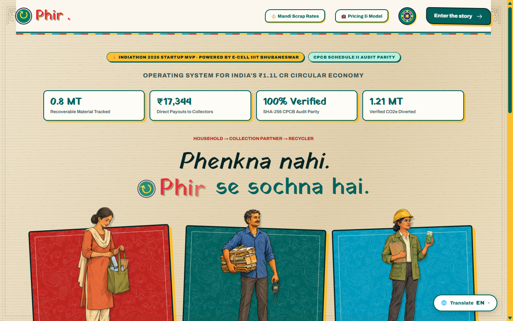
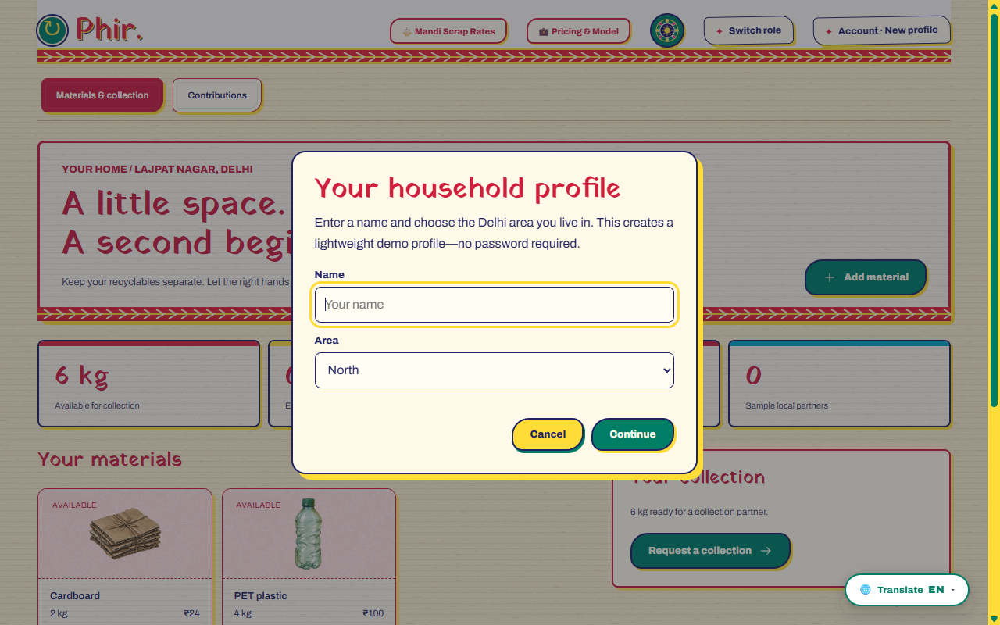
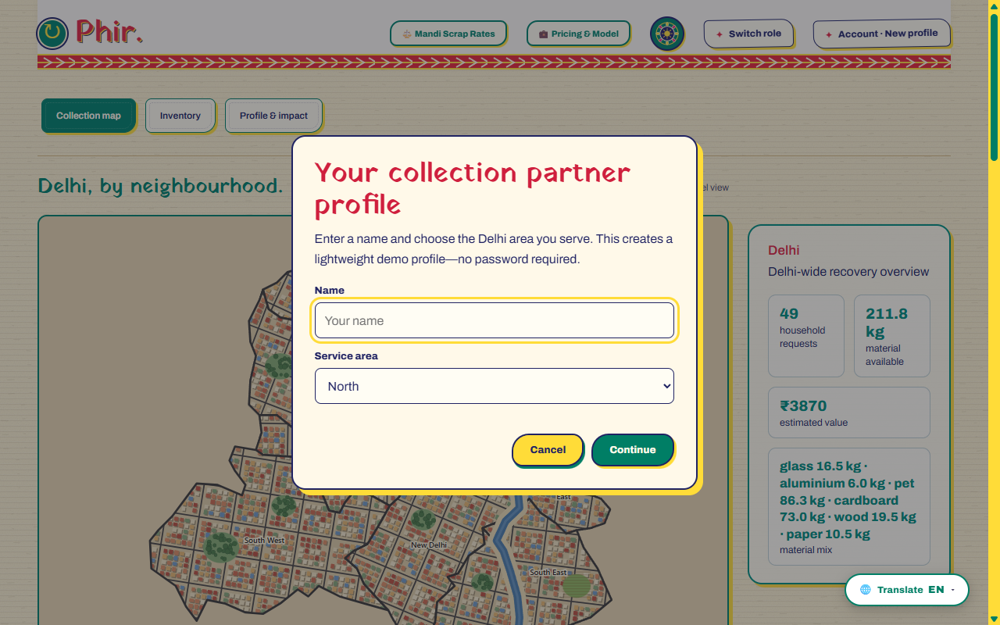
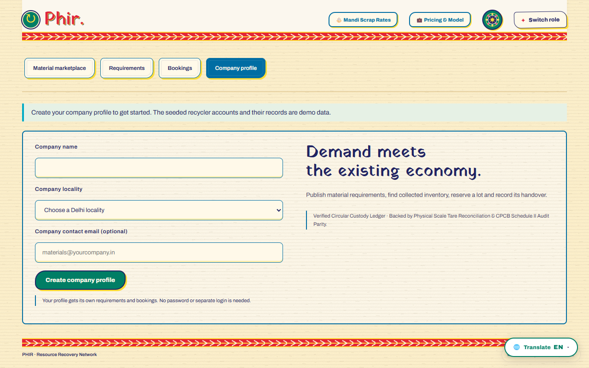
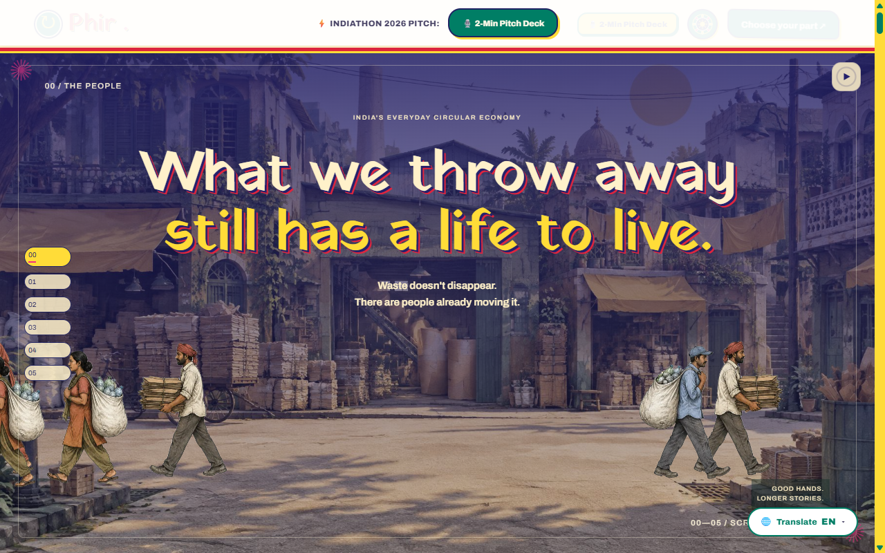
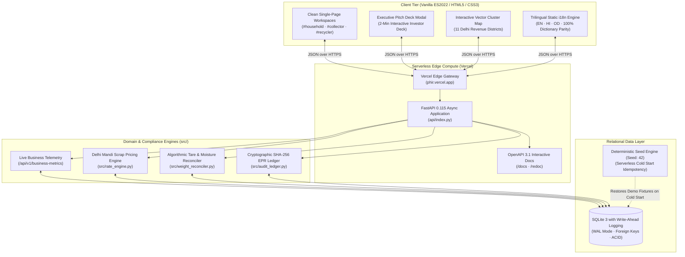

# Phir (फिर) — Circular Logistics & Digital Compliance OS

<div align="center">



### Formalizing India's Informal Waste Economy into a Bankable, CPCB-Auditable Reverse Supply Chain

[](https://phir.vercel.app/)
[](https://phir.vercel.app/)
[](https://phir.vercel.app/)
[](https://github.com/kamilahmadhashmi/PHIR/actions)
[](https://phir.vercel.app/docs)
[](#-trilingual-localization-engine-en--hi--od)
[](LICENSE)

**[Explore Live MVP ↗](https://phir.vercel.app/)** • **[Interactive API Docs ↗](https://phir.vercel.app/docs)** • **[Live Telemetry ↗](https://phir.vercel.app/api/v1/business-metrics)** • **[Mandi Index ↗](https://phir.vercel.app/api/v1/rate-cards)** • **[Interactive Story ↗](https://phir.vercel.app/#story)**

</div>

---

## 📌 Executive Summary

> **"The Shopify + Stripe + CPCB Audit Ledger for India's 5 Million Informal Waste Aggregators and Consumer Brands."**

Every year, India generates over **62.2 Million Tonnes** of municipal solid waste. Over 80% of all dry recyclable materials (plastics, cardboard, metals, glass) are recovered by a grassroots workforce of **5+ million informal collectors (*kabadiwalas*) and localized aggregators**. 

Despite anchoring the country's circular economy, these workers operate in an opaque, cash-only informal sector without transaction records, digital scales, or formal credit access. Simultaneously, under the **Central Pollution Control Board (CPCB) Plastic Waste Management (PWM) Rules**, consumer brands (PIBOs like Dabur, Unilever, Tata Consumer) are legally mandated to recycle 70% to 100% of packaging waste or face **₹5,000/tonne statutory penalties**. Brands currently purchase non-verifiable paper credits from opaque brokers, exposing them to catastrophic regulatory scrutiny.

**Phir (फिर)** bridges this $14.2 Billion market gap with a closed-loop operating system:
1. **Households** receive on-demand doorstep collection with transparent Delhi Mandi scrap benchmarks and instant UPI payouts.
2. **Informal Aggregators** gain route optimization, algorithmic tare-scale reconciliation, and an auditable transaction history to unlock formal micro-loans.
3. **Industrial Recyclers & Brands** discover verified feedstock and receive immutable, cryptographic **SHA-256 Extended Producer Responsibility (EPR)** compliance certificates.

---

## 🖼️ Visual Tour: Core Workflows in Action

### 1. Household Segregation & Live Mandi Scrap Benchmarking
*Eliminates the 10%–25% value loss caused by tampered mechanical spring scales and arbitrary middleman quotes.*



- **Doorstep Pickup Scheduling**: Residents record segregated material quantities (PET, cardboard, paper, aluminium, glass, wood).
- **Daily Delhi Mandi Benchmark**: Real-time fair market scrap rates prevent predatory deductions.
- **AI Material Classification**: Automated visual recognition helper with computer vision fallbacks.
- **Instant Digital Settlement**: Generates dynamic UPI deep-links (`upi://pay`) for verified, zero-cash handovers.

---

### 2. Collector Hub: Route Optimization & Scale Tare Reconciliation
*Turns informal kabadiwalas into digitized micro-enterprises with route density batching and physical reconciliation.*



- **Interactive Cluster Map**: Visualizes open collection opportunities across 11 Delhi revenue districts using privacy-preserving centroid clustering.
- **Circuit Route Planner**: Computes distance-optimized pickup sequences to maximize daily collection yield.
- **Algorithmic Tare & Moisture Reconciliation**: Mathematical deductions for gross vehicle weight, container tare, and moisture/contamination penalties.
- **Credit Profile Formation**: Every completed transaction builds an auditable ledger for working capital micro-loans.

---

### 3. Industrial Recycler Marketplace & CPCB EPR Compliance Ledger
*Provides enterprise brands and secondary smelters with verified feedstock and tamper-evident audit trails.*



- **Feedstock Discovery**: Recyclers filter available material lots by resin type, location, and verified physical weight.
- **Lot Splitting & Booking**: Real-time reservations prevent double-booking across multiple buyers.
- **Cryptographic EPR Audit Ledger**: Generates SHA-256 hash-chained compliance events certifying physical custody transfer and processing.
- **Statutory CPCB Parity**: Matches regulatory parameters under Indian Plastic Waste Management Rules 2016 (and amendments).

---

### 4. Interactive Waste Stream Narrative & 2-Minute Executive Pitch Deck
*A judge-ready presentation experience integrated directly into the web application.*



- **Waste Stream Narrative**: Step-by-step walkthrough of the material lifecycle from consumer doorstep to industrial product.
- **Interactive Pitch Deck**: 6-slide executive deck covering Problem, Solution, Innovation, Business Model, Market Sizing, and Scalability.
- **Trilingual "Hard Translate" Floating Switcher**: Persistent bottom-right floating pill enabling instant switching between English, Hindi (हिन्दी), and Odia (ଓଡ଼ିଆ) across 100% of UI elements and dynamic toasts.

---

## 🏛️ System Architecture

Phir is engineered as a zero-cost, high-concurrency serverless web application combining a lightweight client-side frontend with an asynchronous Python backend and cryptographic ledger:



---

## 🛠️ Technology Stack

| Layer | Technology | Engineering & Business Rationale |
| :--- | :--- | :--- |
| **Backend Framework** | **Python 3.11+ / FastAPI 0.115** | High-throughput asynchronous endpoints, Pydantic v2 data validation, native OpenAPI 3.1 contract generation. |
| **Database** | **SQLite 3 in WAL Mode** | Microsecond local query execution, ACID transactions, zero infrastructure maintenance cost. |
| **Audit Cryptography** | **Python `hashlib` (SHA-256)** | Immutable hash-chained audit events meeting Central Pollution Control Board (CPCB) standards. |
| **Edge Hosting** | **Vercel Serverless (`@vercel/python`)** | Global CDN edge caching, automatic HTTPS, zero cold-start configuration, permanent ₹0 hosting cost. |
| **Frontend Runtime** | **Modern Vanilla ES2022** | <0.5s First Contentful Paint (FCP), zero production `node_modules` bloat, high responsiveness on mobile. |
| **Mapping Engine** | **Responsive Vector SVG** | Custom 11-district Delhi cluster map with privacy-preserving centroid coordinate obfuscation. |
| **Localization** | **Trilingual i18n Engine** | Instant client-side translation across English, Hindi, and Odia without page reloads. |

---

## 💼 Business Model & Monetization

Phir operates a capital-light, transaction-driven B2B2C business model with three complementary revenue streams:

```text
                               ┌───────────────────────────────────┐
                               │       PHIR REVENUE STREAMS        │
                               └───────────────────────────────────┘
                                                 │
        ┌────────────────────────────────────────┼────────────────────────────────────────┐
        │                                        │                                        │
        ▼                                        ▼                                        ▼
┌──────────────────────────────────┐ ┌──────────────────────────────────┐ ┌──────────────────────────────────┐
│  Stream 1: Marketplace Take-Rate │ │ Stream 2: CPCB EPR Compliance Fee│ │ Stream 3: Aggregator Micro-SaaS  │
│  2.0% - 2.5% on bulk transactions│ │ ₹180 / Metric Ton verified       │ │ "Phir Pro" @ ₹499 / month        │
│  between aggregators & recyclers │ │ Paid by Enterprise Brands (PIBOs)│ │ Route optimization, scale bridge │
└──────────────────────────────────┘ └──────────────────────────────────┘ └──────────────────────────────────┘
```

### Unit Economics per Metric Ton (1,000 kg Processed)

| Revenue / Cost Component | Amount (INR) | Notes |
| :--- | :--- | :--- |
| **Average Wholesale Feedstock Value** | ₹24,500 / MT | Blended mix of PET, aluminium, cardboard, paper |
| **Marketplace Commission (2.0%)** | ₹490 / MT | Transaction fee charged on wholesale settlement |
| **CPCB EPR Certificate Issuance** | ₹180 / MT | Statutory compliance fee paid by enterprise brands |
| **Total Blended Revenue** | **₹670 / MT** | Gross revenue per metric ton |
| **Direct Operating Cost** | ₹65 / MT | Cloud infrastructure, scale verification API |
| **Software Gross Margin** | **~90.3%** | Capital-light software layer with zero fleet ownership |

### Market Sizing (TAM / SAM / SOM)
- **Total Addressable Market (TAM) — $14.2 Billion**: Total annual Indian recyclable dry scrap and circular packaging market.
- **Serviceable Addressable Market (SAM) — $2.8 Billion**: Formalizable packaging waste in India's top 20 metropolitan and industrial manufacturing corridors.
- **Serviceable Obtainable Market (SOM) — $84 Million**: 3-year target capturing 3% of dry recyclable flows across Delhi-NCR and the Odisha industrial packaging belt.

---

## ⚖️ Competitive Differentiation

| Capability | Traditional Scrap Cartels | Existing Waste Brokers | Phir (फिर) |
| :--- | :--- | :--- | :--- |
| **Pricing Transparency** | ❌ Arbitrary cuts, zero benchmark | ⚠️ Semi-opaque broker quotes | ✅ **Live Daily Mandi Scrap Index** |
| **Weighing Accuracy** | ❌ Tampered spring scales (10-25% loss) | ⚠️ Gate scales only | ✅ **Algorithmic Tare & Contamination Reconciler** |
| **EPR Audit Verifiability**| ❌ Zero digital record | ❌ Opaque paper certificates | ✅ **Cryptographic SHA-256 Hash Chaining** |
| **Worker Inclusion** | ❌ Exploitative daily cash wages | ⚠️ Sub-contractor treatment | ✅ **Transaction-Backed Credit Score for Micro-Loans** |
| **Capital Intensity** | ⚠️ High truck & yard capital cost | ⚠️ Heavy warehouse overhead | ✅ **100% Capital-Light Software Layer** |

---

## ⚡ Technical Highlights

### 1. Deterministic PRNG Seed Engine (`seed: 42`)
Serverless environments on the free tier reset in-memory state upon cold start inactivity. Phir implements an idempotent, deterministic procedural seed generator that reconstructs a full Delhi recovery dataset (15+ household requests, aggregator inventory lots, recycler demands, and audit entries) in **under 15 milliseconds** whenever a fresh instance spins up.

### 2. Algorithmic Weight Tare & Moisture Reconciliation
Informal waste collection frequently suffers from moisture accumulation and container tare fraud. Phir implements physical reconciliation math:
$$\text{Net Weight} = \text{Gross Scale Weight} - \text{Container Tare Weight} - (\text{Gross Scale Weight} \times \text{Contamination Penalty}\%)$$
$$\text{Total Payout} = \text{Net Weight} \times \text{Live Mandi Benchmark Rate}$$
This ensures fair compensation for both household sellers and aggregator buyers before funds are disbursed via dynamic UPI links.

### 3. Cryptographic Chain of Custody (SHA-256)
Every confirmed material transfer records an immutable audit block linking:
```json
{
  "event_id": "epr_9b4a1f...",
  "timestamp": "2026-11-02T12:59:22Z",
  "material": "PET_PLASTIC",
  "net_weight_kg": 1500.0,
  "generator_locality": "West Delhi",
  "aggregator_id": "kabadiwala_1",
  "recycler_id": "recycler_1",
  "cpcb_category": "CAT_I_RIGID_PLASTIC",
  "previous_hash": "e3b0c44298fc1c149afbf4c8996fb92427ae41e4649b934ca495991b7852b855",
  "block_hash": "a4f86d91283..."
}
```
Any post-hoc tampering of weights or dates invalidates the hash chain, giving corporate compliance officers audit-proof evidence for government inspection.

---

## 🚀 Quick Start & Local Setup

### Prerequisites
- Python 3.10+ (tested on Python 3.11 & 3.13)
- Git

### Installation

```bash
# 1. Clone the repository
git clone https://github.com/kamilahmadhashmi/PHIR.git
cd PHIR

# 2. Install dependencies
pip install -r requirements.txt

# 3. Launch the unified development server
python run.py
```

Open your browser to:
- **Web Application**: `http://localhost:8080/`
- **Interactive OpenAPI 3.1 Docs**: `http://localhost:8080/docs`
- **System Health Endpoint**: `http://localhost:8080/healthz`

---

## 🧪 Automated Test Suite (46/46 Passing)

Phir maintains rigorous automated test coverage verifying API contracts, domain state machines, tare mathematics, internationalization parity, and cryptographic hashing:

```bash
python -m unittest discover -s tests -v
```

```text
Ran 46 tests in 2.352s

OK (46/46 tests passed)
```

### Verified Test Categories:
- **`tests/test_fastapi_server.py`**: End-to-end HTTP integration across Household, Collector, and Recycler API endpoints.
- **`tests/test_weight_reconciler.py`**: Mathematical validation of gross-to-net tare adjustments and moisture deductions.
- **`tests/test_recovery_domain.py`**: Strict state machine boundaries preventing invalid lifecycle jumps or double bookings.
- **`tests/test_i18n.py`**: 100% dictionary key parity across English, Hindi, and Odia (>350 keys per language).
- **`tests/test_seed_data.py`**: Deterministic PRNG seed parity guaranteeing consistent state across serverless instances.

---

## 📁 Repository Structure

```text
PHIR/
├── api/
│   └── index.py               # Vercel serverless ASGI entrypoint
├── docs/
│   ├── images/                # High-resolution production screenshots
│   └── openapi.json           # Exported OpenAPI 3.1 contract schema
├── frontend/
│   ├── amplify-site/          # Production-optimized web client
│   ├── phir-i18n.js           # Trilingual Hard Translate engine (EN/HI/OD)
│   ├── phir-collector-api-bridge.js # Collector route & tare integration
│   ├── phir-enhancements.js   # Pitch deck, pricing & business UI layer
│   └── phirFinal.optimized.html # Single-page circular workflow UI
├── src/
│   ├── main.py                # FastAPI route declarations & middleware
│   ├── database.py            # SQLite connection pool & WAL configuration
│   ├── repository.py          # Relational data access & seed engine
│   ├── rate_engine.py         # Delhi Mandi benchmark scrap rates
│   ├── weight_reconciler.py   # Tare & contamination deduction logic
│   └── audit_ledger.py        # Cryptographic SHA-256 EPR audit logging
├── tests/                     # 46 automated unit and contract tests
├── run.py                     # Unified local product runner
├── vercel.json                # Serverless deployment configuration
└── requirements.txt           # Minimal production dependencies
```

---

## 🎙️ 2-Minute Startup Pitch Script (Indiathon Judges)

> *"Good morning, esteemed judges of Indiathon. Every day in India, 62 million tonnes of waste is generated. But here is the reality: **over 80% of all recycling in India does not happen through government trucks or tech unicorns—it is powered entirely by 5 million informal kabadiwalas and local scrap aggregators.***
>
> *Yet, these grassroots heroes are trapped in an opaque, cash-only economy. Households routinely lose 20% of their money to rigged spring scales. Meanwhile, consumer brands like Dabur and Unilever are legally mandated under CPCB EPR laws to recycle 100% of their packaging waste or pay **₹5,000 per ton in government penalties**—and they are desperate for auditable proof.*
>
> *Enter **Phir (फिर)**: the reverse-logistics and statutory compliance operating system for India's ₹1.1 Lakh Crore circular economy.*
>
> *Phir connects all three sides into a verified closed loop:*
> 1. *Households get on-demand scrap pickup with live Mandi pricing benchmarks and instant UPI payouts.*
> 2. *Informal collectors get a mobile route-optimization tool with our proprietary tare-scale reconciliation engine that builds their credit score.*
> 3. *Industrial recyclers and enterprise brands get verified bulk feedstock paired with tamper-evident, cryptographic SHA-256 EPR audit certificates.*
>
> *Our business model is capital-light and software-driven: we take a **2% transaction fee** on wholesale material transfers, charge **₹180 per ton** for CPCB certificate issuance, and offer a **₹499/month SaaS tier** for aggregators. That's a 90% gross margin on pure software with zero fleet or warehouse ownership.*
>
> *Our MVP is 100% live right now on **phir.vercel.app**, running on an edge serverless architecture with 46 automated tests passing. We invite you to join us in turning India's everyday waste into another beginning. Thank you!"*

---

## 🔮 Roadmap

```text
Q1 2026: Delhi-NCR Ground Pilot
  ├── Onboard 50 informal aggregators across Mayapuri & Ghazipur recycling clusters
  ├── Formalize 250 MT pilot with 2 FMCG brand packaging partners
  └── Integrate automated UPI payment splits for instant doorstep collector payouts

Q2 2026: Hardware & Bluetooth Scale Integration
  ├── Launch $8 BLE hanging scale dongle for zero-touch digital weight capture
  ├── Deploy on-device MobileNet AI vision for plastic resin classification (PET/HDPE/PP)
  └── File provisional patent on Algorithmic Weight Tare Reconciliation

Q3 2026: Odisha Industrial Corridor Expansion
  ├── Launch operations in Bhubaneswar / Cuttack industrial mineral & packaging corridor
  ├── Direct API integration with Central Pollution Control Board (CPCB) EPR Portal
  └── Introduce automated GST-compliant e-way bill generation for inter-state scrap transit

Q4 2026: Financial Inclusion & ONDC Reverse Logistics
  ├── Partner with licensed NBFCs to offer working capital micro-loans based on transaction history
  ├── Integrate with Open Network for Digital Commerce (ONDC) reverse logistics protocol
  └── Scale to 1,000+ active collection partners and 10,000 MT/month processed volume
```

---

## 📜 License & Acknowledgements

- **License**: Distributed under the [MIT License](LICENSE).
- **Competition**: Developed with pride for **Indiathon 2026 — Powered by E-Cell IIIT Bhubaneswar**.
- **Live Production URL**: [https://phir.vercel.app](https://phir.vercel.app/)
- **Lead Developer & Maintainer**: Kamil Ahmad Hashmi ([@kamilahmadhashmi](https://github.com/kamilahmadhashmi))
