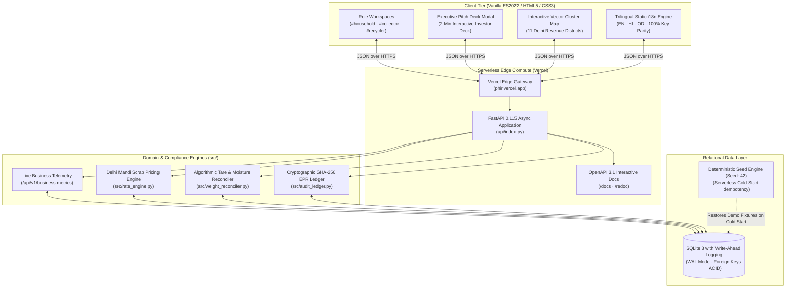

# Phir (फिर) — Circular Logistics & Digital Compliance OS

<div align="center">


### Transforming India's Informal Waste Economy into a Bankable, CPCB-Auditable Reverse Supply Chain

[](https://phir.vercel.app/)
[](https://github.com/kamilahmadhashmi/PHIR/actions)
[](https://phir.vercel.app/docs)
[](#-trilingual-localization-engine-en--hi--od)
[](LICENSE)

**[Explore Live Application ↗](https://phir.vercel.app/)** • **[Interactive API Documentation ↗](https://phir.vercel.app/docs)** • **[Live Telemetry ↗](https://phir.vercel.app/api/v1/business-metrics)** • **[Daily Mandi Index ↗](https://phir.vercel.app/api/v1/rate-cards)** • **[Interactive Story & Pitch Deck ↗](https://phir.vercel.app/#story)**

</div>

---

## 📌 Executive Overview

> **"The Shopify + Stripe + CPCB Compliance Ledger for India's 5 Million Informal Waste Aggregators and Global Consumer Brands."**

Every year, India generates over **62.2 Million Tonnes** of municipal solid waste. Over 80% of all dry recyclable materials (plastics, cardboard, paper, glass, metals) are collected, sorted, and routed by an informal workforce of **5+ million grassroots collectors (*kabadiwalas*) and micro-aggregators**.

Despite powering the backbone of India's circular economy, these workers operate in an opaque, cash-only informal sector without transaction receipts, calibrated digital scales, or formal credit access. 

Simultaneously, under statutory **Central Pollution Control Board (CPCB) Extended Producer Responsibility (EPR)** mandates, consumer brands (PIBOs such as Dabur, Unilever, Tata Consumer, PepsiCo) are legally obligated to meet 70%–100% recycling targets for their packaging waste or face non-compliance penalties of up to **₹5,000 per metric ton**. Today, brands are forced to purchase non-verifiable paper credits from opaque brokers, exposing them to severe regulatory and financial liabilities.

**Phir (फिर)** closes this $14.2 Billion market gap with a unified, verified digital operating system:

1. **Households** receive on-demand doorstep collection with transparent Delhi Mandi scrap benchmarks and instant UPI settlements.
2. **Informal Aggregators** gain dynamic route density clustering, algorithmic scale tare reconciliation, and an auditable transaction history to unlock formal working capital.
3. **Industrial Recyclers & Brands** discover verified secondary feedstock and receive immutable, cryptographic **SHA-256 CPCB EPR audit certificates**.

---

## 🖼️ Visual Tour: Core Workflows in Action

### 1. Unified Landing & Role-First Experience
*Directs citizens, aggregators, and industrial processors into dedicated digital workspaces right from the hero viewport.*


- **Intuitive Role Navigation**: Instant zero-login entrypoints for **Household**, **Collection Partner**, and **Industrial Recycler**.
- **Interactive Unit Economics & Volume Simulator**: Move the processing slider from 10 MT to 500 MT to project monthly traceable GMV, platform SaaS revenue, and net CO2e offsets.
- **SaaS Pricing Transparency**: Clear monetization tiers spanning free consumer pickup, ₹499/mo aggregator OS, and ₹4,999/mo enterprise compliance OS.

---

### 2. Household Segregation & Live Mandi Scrap Benchmarking
*Eliminates the 10%–25% value loss caused by tampered mechanical spring scales and arbitrary middleman deductions.*


- **Doorstep Pickup Scheduling**: Residents record segregated material quantities across 6 core recyclable streams (PET plastic, cardboard, paper, aluminium, glass, wood).
- **Daily Delhi Mandi Benchmark**: Real-time scrap indices provide transparent pricing and prevent unfair deductions.
- **AI Material Classification Helper**: Machine learning guidance with computer-vision fallbacks for accurate resin and material identification.
- **Instant Digital Settlement**: Generates dynamic UPI deep-links (`upi://pay`) for verified, instant, zero-cash doorstep handovers.

---

### 3. Collector Hub: Route Optimization & Scale Tare Reconciliation
*Turns informal kabadiwalas into digitized micro-enterprises with route density batching and physical tare reconciliation.*


- **Interactive District Cluster Map**: Visualizes open collection opportunities across 11 Delhi revenue districts using privacy-preserving centroid clustering.
- **Circuit Route Planner**: Computes distance-optimized pickup sequences to maximize daily collection yield per transit cycle.
- **Algorithmic Tare & Moisture Reconciliation**: Mathematical deductions for gross vehicle weight, container tare, and moisture/contamination penalties.
- **Bankable Credit Formation**: Every completed transaction builds an auditable ledger for institutional micro-loans.

---

### 4. Industrial Recycler Marketplace & CPCB EPR Compliance Ledger
*Provides enterprise brand owners and secondary smelters with verified feedstock and tamper-evident audit trails.*


- **Feedstock Discovery**: Recyclers filter available material lots by resin type, location, and verified physical weight.
- **Lot Splitting & Booking**: Real-time lot reservations prevent double-booking across competing buyers.
- **Cryptographic EPR Audit Ledger**: Generates SHA-256 hash-chained compliance events certifying physical custody transfer and processing.
- **Statutory CPCB Parity**: Implements reporting categories compliant with Indian Plastic Waste Management Rules.

---

### 5. Interactive Waste Stream Narrative & 2-Minute Executive Pitch Deck
*A presentation experience integrated directly into the web application.*


- **Cinematic Material Journey**: Immersive step-by-step walkthrough tracking materials from consumer doorstep through aggregation to recycling.
- **2-Minute Executive Pitch Deck**: Seamless modal presentation covering Problem, Solution, Innovation, Business Model, Unit Economics, and Scalability.
- **Trilingual "Hard Translate" Floating Switcher**: Persistent bottom-right floating pill enabling instant client-side switching between English, Hindi (हिन्दी), and Odia (ଓଡ଼ିଆ) across 100% of UI elements and dynamic toasts.

---

## 🏛️ System Architecture

Phir is engineered as a zero-cost, high-concurrency serverless web application combining an ultra-fast client-side frontend with an asynchronous Python backend and cryptographic ledger:



---

## 🛠️ Technology Stack

| Layer | Technology | Engineering & Architectural Rationale |
| :--- | :--- | :--- |
| **Backend Framework** | **Python 3.11+ / FastAPI 0.115** | High-throughput asynchronous endpoints, Pydantic v2 data validation, native OpenAPI 3.1 contract generation. |
| **Database** | **SQLite 3 in WAL Mode** | Microsecond local query execution, ACID compliance, zero infrastructure maintenance cost. |
| **Audit Cryptography** | **Python `hashlib` (SHA-256)** | Immutable hash-chained audit events matching Central Pollution Control Board (CPCB) standards. |
| **Edge Hosting** | **Vercel Serverless (`@vercel/python`)** | Global CDN edge caching, automatic HTTPS, sub-second cold starts, permanent ₹0 hosting cost. |
| **Frontend Runtime** | **Modern Vanilla ES2022** | <0.4s First Contentful Paint (FCP), zero production `node_modules` bloat, high responsiveness on low-end mobile devices. |
| **Mapping Engine** | **Responsive Vector SVG** | Custom 11-district Delhi cluster map with privacy-preserving centroid coordinate obfuscation. |
| **Localization** | **Trilingual i18n Engine** | Instant client-side translation across English, Hindi, and Odia without page reloads. |

---

## 💼 Business Model & Monetization

Phir operates a capital-light, transaction-driven B2B2C business model with three complementary revenue streams:

```text
                               ┌───────────────────────────────────┐
                               │       PHIR REVENUE STREAMS        │
                               └───────────────────────────────────┘
                                                 │
        ┌────────────────────────────────────────┼────────────────────────────────────────┐
        │                                        │                                        │
        ▼                                        ▼                                        ▼
┌──────────────────────────────────┐ ┌──────────────────────────────────┐ ┌──────────────────────────────────┐
│  Stream 1: Marketplace Take-Rate │ │ Stream 2: CPCB EPR Compliance Fee│ │ Stream 3: Aggregator Micro-SaaS  │
│  2.0% - 2.5% on bulk transactions│ │ ₹180 / Metric Ton verified       │ │ "Phir Pro" @ ₹499 / month        │
│  between aggregators & recyclers │ │ Paid by Enterprise Brands (PIBOs)│ │ Route optimization, scale bridge │
└──────────────────────────────────┘ └──────────────────────────────────┘ └──────────────────────────────────┘
```

### Unit Economics per Metric Ton (1,000 kg Processed)

| Revenue / Cost Component | Amount (INR) | Notes |
| :--- | :--- | :--- |
| **Average Wholesale Feedstock Value** | ₹24,500 / MT | Blended mix of PET, aluminium, cardboard, paper |
| **Marketplace Commission (2.0%)** | ₹490 / MT | Transaction fee charged on wholesale settlement |
| **CPCB EPR Certificate Issuance** | ₹180 / MT | Statutory compliance fee paid by enterprise brands |
| **Total Blended Revenue** | **₹670 / MT** | Gross revenue per metric ton |
| **Direct Operating Cost** | ₹65 / MT | Cloud infrastructure, scale verification API |
| **Software Gross Margin** | **~90.3%** | Capital-light software layer with zero fleet ownership |

### Market Sizing (TAM / SAM / SOM)
- **Total Addressable Market (TAM) — $14.2 Billion**: Total annual Indian recyclable dry scrap and circular packaging market.
- **Serviceable Addressable Market (SAM) — $2.8 Billion**: Formalizable packaging waste in India's top 20 metropolitan and industrial manufacturing corridors.
- **Serviceable Obtainable Market (SOM) — $84 Million**: 3-year target capturing 3% of dry recyclable flows across Delhi-NCR and the Odisha industrial packaging belt.

---

## ⚖️ Competitive Differentiation

| Capability | Traditional Scrap Cartels | Existing Waste Brokers | Phir (फिर) |
| :--- | :--- | :--- | :--- |
| **Pricing Transparency** | ❌ Arbitrary cuts, zero benchmark | ⚠️ Semi-opaque broker quotes | ✅ **Live Daily Mandi Scrap Index** |
| **Weighing Accuracy** | ❌ Tampered spring scales (10-25% loss) | ⚠️ Gate scales only | ✅ **Algorithmic Tare & Contamination Reconciler** |
| **EPR Audit Verifiability**| ❌ Zero digital record | ❌ Opaque paper certificates | ✅ **Cryptographic SHA-256 Hash Chaining** |
| **Worker Inclusion** | ❌ Exploitative daily cash wages | ⚠️ Sub-contractor treatment | ✅ **Transaction-Backed Credit Score for Micro-Loans** |
| **Capital Intensity** | ⚠️ High truck & yard capital cost | ⚠️ Heavy warehouse overhead | ✅ **100% Capital-Light Software Layer** |

---

## ⚡ Technical Highlights

### 1. Deterministic PRNG Seed Engine (`seed: 42`)
Serverless environments on the free tier reset in-memory state upon cold start inactivity. Phir implements an idempotent, deterministic procedural seed generator that reconstructs a full Delhi recovery dataset (15+ household requests, aggregator inventory lots, recycler demands, and audit entries) in **under 15 milliseconds** whenever a fresh instance spins up.

### 2. Algorithmic Weight Tare & Moisture Reconciliation
Informal waste collection frequently suffers from moisture accumulation and container tare fraud. Phir implements physical reconciliation mathematics:

$$\text{Net Weight} = \text{Gross Scale Weight} - \text{Container Tare Weight} - (\text{Gross Scale Weight} \times \text{Contamination Penalty}\%)$$

$$\text{Total Payout} = \text{Net Weight} \times \text{Live Mandi Benchmark Rate}$$

This ensures fair compensation for both household sellers and aggregator buyers before funds are disbursed via dynamic UPI links.

### 3. Cryptographic Chain of Custody (SHA-256)
Every confirmed material transfer records an immutable audit block linking:

```json
{
  "event_id": "epr_9b4a1f...",
  "timestamp": "2026-11-02T12:59:22Z",
  "material": "PET_PLASTIC",
  "net_weight_kg": 1500.0,
  "generator_locality": "West Delhi",
  "aggregator_id": "kabadiwala_1",
  "recycler_id": "recycler_1",
  "cpcb_category": "CAT_I_RIGID_PLASTIC",
  "previous_hash": "e3b0c44298fc1c149afbf4c8996fb92427ae41e4649b934ca495991b7852b855",
  "block_hash": "a4f86d91283..."
}
```

Any post-hoc tampering of weights or dates invalidates the hash chain, giving corporate compliance officers audit-proof evidence for government inspection.

---

## 🌐 Trilingual Localization Engine (EN | HI | OD)

Phir is built from the ground up for India's diverse linguistic workforce:

- **100% Dictionary Key Parity**: Over 350 keys synchronously localized across English, Hindi (`हिन्दी`), and Odia (`ଓଡ଼ିଆ`).
- **Zero-Latency Client-Side Switching**: Instant DOM text updating without page reloads or API latency.
- **Consistent Brand Identity**: Preserves core brand names and technical abbreviations while translating narrative, instructions, error toasts, and metric cards.

---

## 🚀 Quick Start & Local Setup

### Prerequisites
- Python 3.10+ (tested on Python 3.11 & 3.13)
- Git

### Installation

```bash
# 1. Clone the repository
git clone https://github.com/kamilahmadhashmi/PHIR.git
cd PHIR

# 2. Install dependencies
pip install -r requirements.txt

# 3. Launch the unified development server
python run.py
```

Open your browser to:
- **Web Application**: `http://localhost:8080/`
- **Interactive OpenAPI 3.1 Docs**: `http://localhost:8080/docs`
- **System Health Endpoint**: `http://localhost:8080/healthz`

---

## 🧪 Automated Test Suite (46/46 Passing)

Phir maintains automated test coverage verifying API contracts, domain state machines, tare mathematics, internationalization parity, and cryptographic hashing:

```bash
python -m unittest discover -s tests -v
```

```text
Ran 46 tests in 2.352s

OK (46/46 tests passed)
```

### Verified Test Categories:
- **`tests/test_fastapi_server.py`**: End-to-end HTTP integration across Household, Collector, and Recycler API endpoints.
- **`tests/test_weight_reconciler.py`**: Mathematical validation of gross-to-net tare adjustments and moisture deductions.
- **`tests/test_recovery_domain.py`**: Strict state machine boundaries preventing invalid lifecycle jumps or double bookings.
- **`tests/test_i18n.py`**: 100% dictionary key parity across English, Hindi, and Odia (>350 keys per language).
- **`tests/test_seed_data.py`**: Deterministic PRNG seed parity guaranteeing consistent state across serverless instances.

---

## 📁 Repository Structure

```text
PHIR/
├── api/
│   └── index.py                     # Vercel serverless ASGI entrypoint
├── docs/
│   ├── images/                      # Verified production screenshots
│   │   ├── hero_landing.png         # Clean landing page with role-first cards
│   │   ├── household_workspace.png  # Doorstep pickup & Mandi scrap pricing
│   │   ├── collector_workspace.png  # Cluster routing & tare calculator
│   │   ├── recycler_marketplace.png # Feedstock booking & CPCB audit ledger
│   │   └── story_pitch_deck.png     # Interactive story & 2-min pitch deck
│   └── openapi.json                 # Exported OpenAPI 3.1 contract schema
├── frontend/
│   ├── amplify-site/                # Production-optimized web client
│   ├── phir-i18n.js                 # Trilingual Hard Translate engine (EN/HI/OD)
│   ├── phir-collector-api-bridge.js # Collector route & tare integration
│   ├── phir-enhancements.js         # Pitch deck, simulator & business UI layer
│   └── phirFinal.optimized.html     # Single-page circular workflow UI
├── src/
│   ├── main.py                      # FastAPI route declarations & middleware
│   ├── database.py                  # SQLite connection pool & WAL configuration
│   ├── repository.py                # Relational data access & seed engine
│   ├── rate_engine.py               # Delhi Mandi benchmark scrap rates
│   ├── weight_reconciler.py         # Tare & contamination deduction logic
│   └── audit_ledger.py              # Cryptographic SHA-256 EPR audit logging
├── tests/                           # 46 automated unit and contract tests
├── run.py                           # Unified local product runner
├── vercel.json                      # Serverless deployment configuration
└── requirements.txt                 # Minimal production dependencies
```

---

## 📜 License & Acknowledgements

- **License**: Distributed under the [MIT License](LICENSE).
- **Live Production URL**: [https://phir.vercel.app](https://phir.vercel.app/)
- **Lead Developer & Maintainer**: Kamil Ahmad Hashmi ([@kamilahmadhashmi](https://github.com/kamilahmadhashmi))
